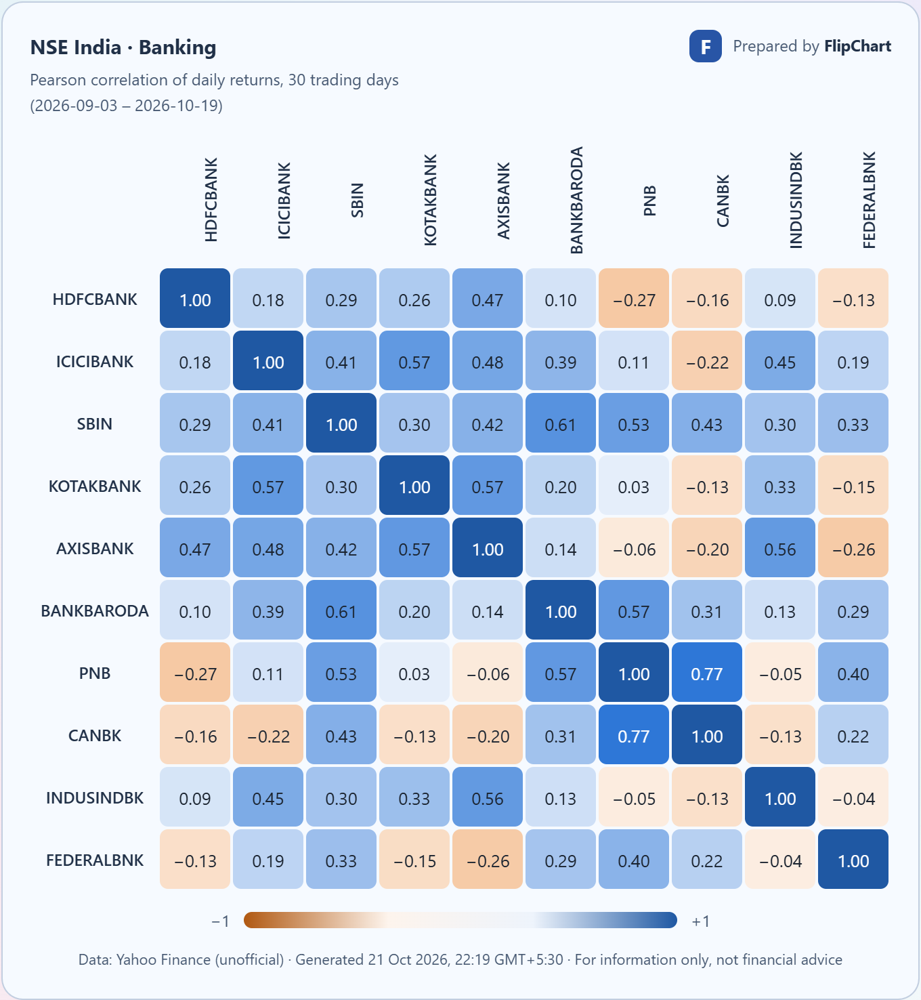
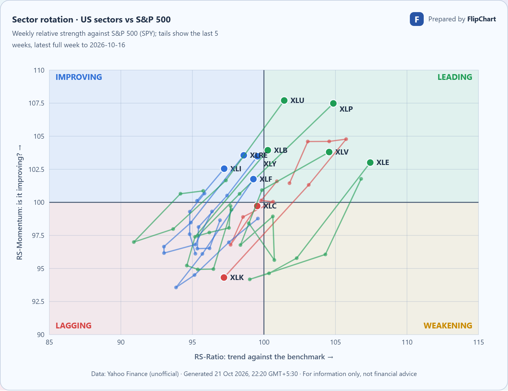

# FlipChart

**Version: [v0.1.11](https://github.com/sahil1115/flipchart/releases/tag/v0.1.11)**

FlipChart is a stock-chart dashboard that runs in your browser. Explore prices, volume, and 15 technical indicators using demo data, your own CSV files, or a market-data API. It also includes a correlation heatmap and a sector-rotation chart for US and Indian markets.

## Run locally

Install [Node.js](https://nodejs.org/) 22.12 or newer, then run:

```sh
git clone https://github.com/sahil1115/flipchart.git
cd flipchart
npm ci
npm run dev
```

Open [http://127.0.0.1:4179](http://127.0.0.1:4179).

No backend, database server, or API key is needed for demo data or CSV imports.

## Use the dashboard

- Choose **Try Demo** to explore the charts immediately.
- Choose **Import CSV** to load daily price data from a file.
- Choose **Connect Provider** (or the data-source button at the top right) to load history from Twelve Data, Alpha Vantage, or Yahoo Finance. See [Connect market data](#connect-market-data).
- Choose a category below the price and volume charts, then choose an indicator. Select readout checkboxes in the dock to choose which values to display.
- Chart overlays and tabs work independently from the readout checkboxes. Use **Expand** at the top of the readout to toggle details for all cards.
- Use the **Momentum** dropdown beside Overlays to draw RSI, MACD, Stoch, CCI, %R, or ROC over the main price chart on an independent scale. Choose **None** to remove it. Lower chart tabs and readout selections remain independent.
- Hover to inspect, click or tap to pin a bar, and use the arrow buttons to step through history.
- Pan and zoom the chart, change the date range, and adjust calculation parameters below the workspace.
- Save listings to your watchlist and export chart data as CSV.
- Choose **Correlation** or **Sector rotation** at the top for market-wide views. See [Market analysis](#market-analysis).
- Open **Settings** (the gear at the top right) to choose a theme: Glass Light, Soft Clay, Midnight Clay, Frosted Mono, Ocean Blue, Plum Noir, Notebook (ruled paper, handwriting and highlighter), or Terminal. The same menu changes the font and text size, picks the heatmap colors (blue and orange, or green and red), reduces visual effects, and resets preferences or clears the cache.
- The Terminal theme offers Dark/White backgrounds and Solar Yellow, Heritage Gold, Electric Blue, Emerald Green, Rose Pink, Royal Purple, or Pure Contrast accents. Pure Contrast uses white on black or black on white.
- Your theme, text, and heatmap color settings stay saved in this browser.

Imported datasets and dashboard preferences stay in this browser when storage is available.

## Market analysis

Both pages load daily history through the local Yahoo relay, so they need `npm run dev` or `npm run preview`. Data is fetched only when you choose **Load**, is kept for the session, and comes from an unofficial Yahoo Finance connection. Each result is a self-contained card: use **Copy image** to paste it into a document or chat, or download it as JPG or CSV.

### Correlation heatmap

See how closely the largest stocks in an industry moved together. Pick a market (Dow Jones, S&P 500, Nasdaq-100, or NSE India), an industry, the top 5 or 10 stocks, a 15- or 30-trading-day period, and whether to correlate daily returns or prices, then choose **Load correlation**. You can edit the ticker list. Colors can be switched between blue and orange and green and red in **Settings**.



_Screenshot from live Yahoo Finance data on 21 October 2026. Values change with the market._

### Sector rotation

See which sectors are beating the market, and whether that is getting stronger or weaker. Pick US sectors against the S&P 500 (the SPDR sector ETFs against SPY) or India sectors against the Nifty 50 (NSE-listed sector ETFs against NIFTYBEES), then choose **Load rotation**.

Each dot is a sector on weekly bars. Right of the centre line it is outperforming the benchmark; above the centre line that outperformance is improving. The tail shows the last five weeks, and sectors often move clockwise from Improving to Leading to Weakening to Lagging, though that is a tendency, not a rule.



_Screenshot from live Yahoo Finance data on 21 October 2026. Values change with the market._

How it is calculated:

- RS-Ratio is the sector-to-benchmark price ratio divided by its own 10-week average. RS-Momentum is how much RS-Ratio changed over 4 weeks. Both are centred on 100.
- Only completed weeks are used, so the newest reading is the last full week.
- India uses NSE-listed sector ETFs because Yahoo's history for most NSE sector indices is incomplete.
- This is an openly described measure, not the proprietary Relative Rotation Graph calculation, so values will not match other tools. It describes recent relative performance; it does not predict.

## Theme previews

Screenshots use the built-in synthetic demo data.

**Terminal · black background with Solar Yellow**


**Glass Light**


**Ocean Blue**


## Connect market data

1. Get your own API key from [Twelve Data](https://twelvedata.com/) or [Alpha Vantage](https://www.alphavantage.co/support/#api-key).
2. Select the data-source button at the top right (it reads **Connect data**) to open **Data source**, then choose your provider.
3. Enter the key and select **Use key**.
4. Optionally test the connection, then search for a listing and load its history.

For **Yahoo Finance**, choose it in **Data source**, pick a country (India NSE or United States), then search by company name or ticker, such as `Reliance` or `TCS` for India and `Apple` or `AAPL` for NASDAQ, NYSE and other US exchanges (including Dow and S&P 500 members). Select the match and choose **Load history**. No API key is needed. Daily history is loaded; weekly/monthly views are calculated locally. Index symbols such as `^GSPC` are not supported.

Yahoo uses an unofficial personal-use endpoint through a local relay included in `npm run dev` and `npm run preview`. It may be unavailable or rate limited. Pure static hosting does not include this relay; use CSV imports or another provider there. Yahoo OHLC is used as supplied, with corporate-action adjustment marked unverified. Independently verify data and calculations before making decisions.

Key-based providers use your account and its limits. A connection test can use API credits. Available markets and history depend on your subscription; data refreshes when you request it.

Keys stay in memory unless you select **Remember on this device**. Remembered keys use browser storage. Disconnect removes the saved key. Never commit API keys to Git.

## Build and preview

```sh
npm run build
npm run preview
```

Open [http://127.0.0.1:4179](http://127.0.0.1:4179). Deploy the complete `dist/` folder to static hosting over HTTPS. For hosting under a repository path, set `FLIPCHART_BASE` to that path (for example, `/flipchart/`) before building.

The production app supports offline reopening of demo and imported data after an initial online visit. Provider requests require internet access, and live provider data is kept only for the current session. Installation is optional and depends on browser support.

## Development checks

```sh
npm run check
```

For browser tests:

```sh
npx playwright install chromium firefox webkit
npm run test:e2e
npm run test:subpath
```

## More information

- [Contributing](CONTRIBUTING.md)
- [Security](SECURITY.md)
- [Versions and release notes](https://github.com/sahil1115/flipchart/releases)

## Contributor

Created and maintained by [Sahil (@sahil1115)](https://github.com/sahil1115).

## License

FlipChart is [MIT licensed](LICENSE). Charts use [TradingView Lightweight Charts](https://github.com/tradingview/lightweight-charts); third-party notices are included in the app. Market data remains subject to the provider's terms.
