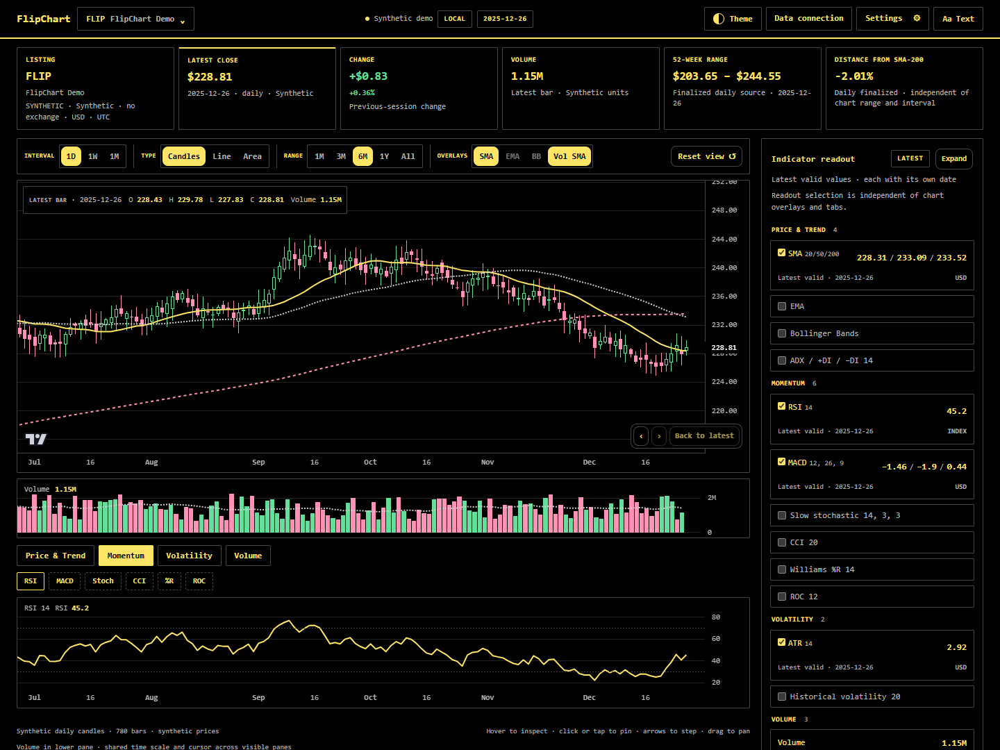
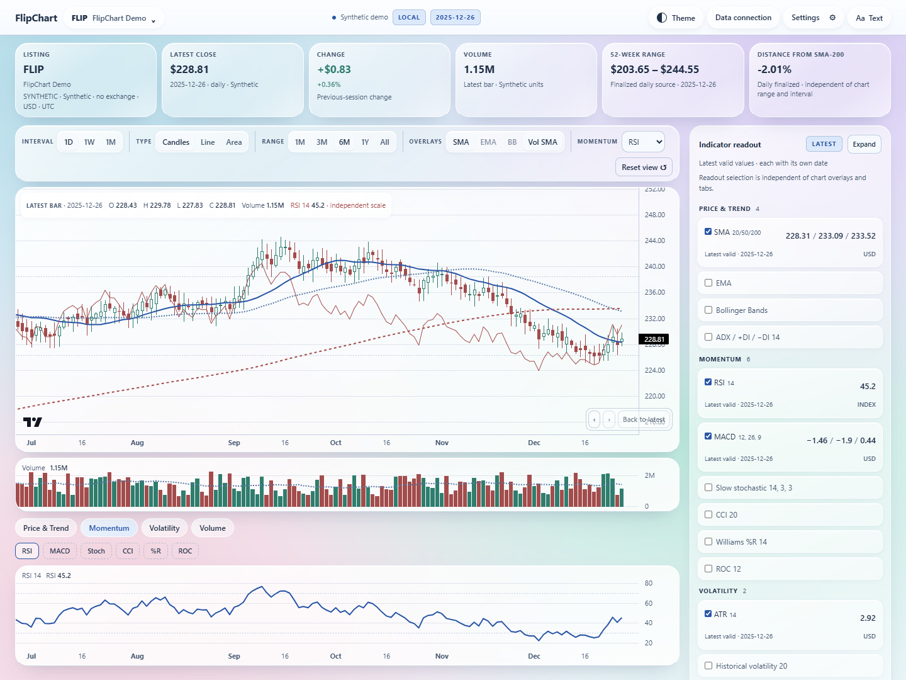
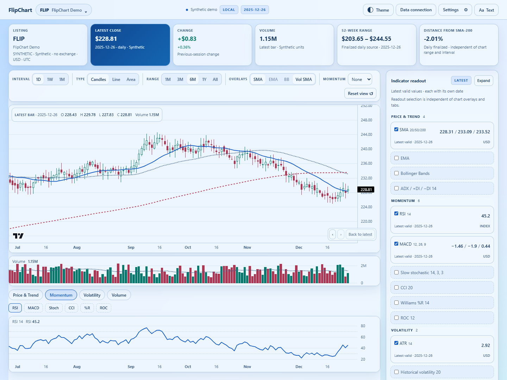

# FlipChart

**Version: [v0.1.9](https://github.com/sahil1115/flipchart/releases/tag/v0.1.9)**

FlipChart is a stock-chart dashboard that runs in your browser. Explore prices, volume, and 15 technical indicators using demo data, your own CSV files, or a market-data API.

## Run locally

Install [Node.js](https://nodejs.org/) 22.12 or newer, then run:

```sh
git clone https://github.com/sahil1115/flipchart.git
cd flipchart
npm ci
npm run dev
```

Open [http://127.0.0.1:4179](http://127.0.0.1:4179).

No backend, database server, or API key is needed for demo data or CSV imports.

## Use the dashboard

- Choose **Try Demo** to explore the charts immediately.
- Choose **Import CSV** to load daily price data from a file.
- Choose a category below the price and volume charts, then choose an indicator. Select readout checkboxes in the dock to choose which values to display.
- Chart overlays and tabs work independently from the readout checkboxes. Use **Expand** at the top of the readout to toggle details for all cards.
- Use the **Momentum** dropdown beside Overlays to draw RSI, MACD, Stoch, CCI, %R, or ROC over the main price chart on an independent scale. Choose **None** to remove it. Lower chart tabs and readout selections remain independent.
- Hover to inspect, click or tap to pin a bar, and use the arrow buttons to step through history.
- Pan and zoom the chart, change the date range, and adjust calculation parameters below the workspace.
- Save listings to your watchlist and export chart data as CSV.
- Choose **Correlation heatmap** at the top to see how closely the largest stocks in an industry moved together. Pick a market (Dow Jones, S&P 500, Nasdaq-100, or NSE India), an industry, the top 5 or 10 stocks, and a 15- or 30-trading-day period, then choose **Load correlation**. Use **Copy image** to paste the branded heatmap into a document, or download it as JPG or CSV. It uses the local Yahoo relay, so it needs `npm run dev` or `npm run preview`.
- Use the top **Theme** button to choose Glass Light, Soft Clay, Midnight Clay, Frosted Mono, Ocean Blue, Plum Noir, Notebook (ruled paper, handwriting and highlighter), or Terminal. Open Settings to reduce visual effects.
- The Terminal theme offers Dark/White backgrounds and Solar Yellow, Heritage Gold, Electric Blue, Emerald Green, Rose Pink, Royal Purple, or Pure Contrast accents. Pure Contrast uses white on black or black on white.
- Use **Text** at the top right to change the font or make text smaller/larger. Your text settings stay saved in this browser.

Imported datasets and dashboard preferences stay in this browser when storage is available.

## Theme previews

Screenshots use the built-in synthetic demo data.

**Terminal · black background with Solar Yellow**



**Glass Light**



**Ocean Blue**



## Connect market data

1. Get your own API key from [Twelve Data](https://twelvedata.com/) or [Alpha Vantage](https://www.alphavantage.co/support/#api-key).
2. Open **Data connection** and choose your provider.
3. Enter the key and select **Use key**.
4. Optionally test the connection, then search for a listing and load its history.

For **Yahoo Finance NSE India**, choose it in **Data connection**, enter an NSE trading symbol such as `RELIANCE`, `TCS`, or `INFY`, select the `.NS` listing, and choose **Load history**. No API key is needed. Daily history is loaded; weekly/monthly views are calculated locally. Company-name lookup is not supported.

Yahoo uses an unofficial personal-use endpoint through a local relay included in `npm run dev` and `npm run preview`. It may be unavailable or rate limited. Pure static hosting does not include this relay; use CSV imports or another provider there. Yahoo OHLC is used as supplied, with corporate-action adjustment marked unverified. Independently verify data and calculations before making decisions.

Key-based providers use your account and its limits. A connection test can use API credits. Available markets and history depend on your subscription; data refreshes when you request it.

Keys stay in memory unless you select **Remember on this device**. Remembered keys use browser storage. Disconnect removes the saved key. Never commit API keys to Git.

## Build and preview

```sh
npm run build
npm run preview
```

Open [http://127.0.0.1:4179](http://127.0.0.1:4179). Deploy the complete `dist/` folder to static hosting over HTTPS. For hosting under a repository path, set `FLIPCHART_BASE` to that path (for example, `/flipchart/`) before building.

The production app supports offline reopening of demo and imported data after an initial online visit. Provider requests require internet access, and live provider data is kept only for the current session. Installation is optional and depends on browser support.

## Development checks

```sh
npm run check
```

For browser tests:

```sh
npx playwright install chromium firefox webkit
npm run test:e2e
npm run test:subpath
```

## More information

- [Contributing](CONTRIBUTING.md)
- [Security](SECURITY.md)
- [Versions and release notes](https://github.com/sahil1115/flipchart/releases)

## Contributor

Created and maintained by [Sahil (@sahil1115)](https://github.com/sahil1115).

## License

FlipChart is [MIT licensed](LICENSE). Charts use [TradingView Lightweight Charts](https://github.com/tradingview/lightweight-charts); third-party notices are included in the app. Market data remains subject to the provider's terms.
